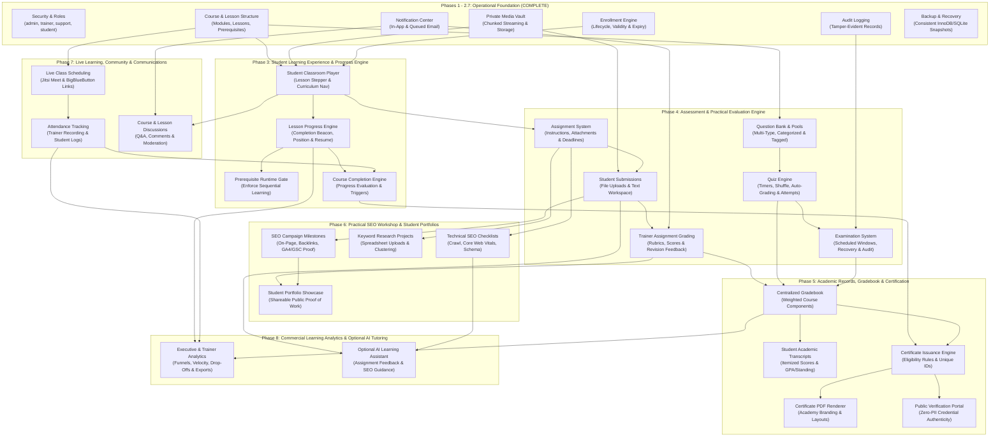

# SEO Academy — LMS Phase Dependency Map & Architecture Graph

**Project:** SEO Academy (`C:\laragon\www\seo-academy`)  
**Scope:** Architectural Dependency Analysis & Phased Implementation Sequencing  
**Guiding Invariant:** Construct capabilities in strict foundational order so no phase requires re-migrating, re-architecting, or refactoring prior work.

---

## 1. Architectural Dependency Diagram

The following Mermaid graph visualizes the structural dependencies across SEO Academy's completed operational foundation (Phases 1–2.7) and the required commercial LMS phases.



---

## 2. Shared Infrastructure Reuse Map

To maintain a lean, high-performance architecture on conventional PHP shared hosting, new LMS modules must strictly leverage existing shared infrastructure rather than introducing redundant tables, duplicate services, or foreign daemons.

| Existing Infrastructure Component | Reused By Target LMS Modules | Implementation Mechanism |
|---|---|---|
| **`PrivateMediaService` & `Media`** | Classroom, Assignments, Projects, Certificates | **Media Authorization Policy:** Must authorize users with an enrollment that is `isValid()` (active and within `starts_at`/`expires_at`) **OR** `completed` (retaining lifetime read-only access). Strictly excludes `expired`, `suspended`, or `cancelled` enrollments. Vaults all course videos, materials, homework submissions, and certificate PDFs outside webroot (`storage/app/private/`). |
| **`AcademyNotificationService`** | Assignments, Quizzes, Grading, Discussions, Live Classes | Reuses notification templates, in-app notification center, user notification preferences, and queued SMTP delivery for assignment deadlines, graded feedback alerts, quiz results, and live class reminders. |
| **`RecordsAuditLog` & `audit_log`** | Grading, Examinations, Certificates, Moderation | Grade manual overrides, exam attempt exceptions/resets, certificate revocations, and discussion moderation actions automatically write tamper-evident audit log entries with actor UUID, IP, and payload diffs. |
| **`TenantContext` & `BelongsToAcademy`** | All new models (`assignments`, `quizzes`, `certificates`, etc.) | Every new table includes `academy_id` foreign key and Eloquent models apply the `BelongsToAcademy` trait, guaranteeing that all queries strictly scope to the single installed academy without leak risks. |
| **`EnrollmentManagementService`** | Classroom Player, Assignments, Quizzes, Certificates | Access gates in the student player, quiz taker, and assignment submitter evaluate `Enrollment::isValid()` semantics (temporal window enforcement) rather than stored status alone. Coordinates with `CourseCompletionService` to transition status to `completed` while preserving read-only learning access. |
| **`CourseCompletionService` (Core)** | Classroom, Assessments, Gradebook, Certificates | Central domain evaluator enforcing multi-component completion rules (100% required lessons completed + passing assignment scores + passing quiz scores + required live attendance + final exam passed). Single source of truth across all learning workflows. |
| **`BackupService`** | Complete Application | Because `BackupService` dynamically reads the PDO table registry and streams all InnoDB/SQLite tables into consistent snapshot dumps, all new tables added via migrations are automatically protected without modifying backup code. |
| **`DatabaseInstallerService`** | Clean Release & Updates | New migrations are appended to `KNOWN_MIGRATIONS`, ensuring fresh installations and installer verification seamlessly incorporate all LMS schema objects. |
| **`AiProviderInterface` & `NullAiProvider`** | AI Tutoring & Grading Assistance | Optional AI features utilize the existing `OpenAiCompatibleProvider` and fallback cleanly to `NullAiProvider` when unconfigured, requiring zero frontend key exposure or mandatory subscriptions. |

---

## 3. Strict Phased Implementation Sequence

Building the LMS in the correct logical sequence prevents rework, duplicate migrations, and schema churn:

```
┌─────────────────────────────────────────────────────────────────────────────┐
│                       STRICT IMPLEMENTATION SEQUENCE                        │
├─────────────────────────────────────────────────────────────────────────────┤
│  Phase 3: Core Student Classroom & Learning Progress Engine                 │
│  ├── 3.1: Student Classroom Player & Curriculum Sidebar Navigation          │
│  ├── 3.2: Media Authorization Re-Audit (`isValid()` || `isCompleted()`)     │
│  ├── 3.3: Lesson Progress Service (Telemetry vs Server-Validated Watch Time)│
│  ├── 3.4: Lesson Prerequisite Runtime Enforcement                          │
│  ├── 3.5: "Resume Last Lesson" Engine & Completed Course Read-Only Access   │
│  └── 3.6: Centralized `CourseCompletionService` Architecture                │
├─────────────────────────────────────────────────────────────────────────────┤
│  Phase 4: Assessment & Practical Evaluation Engine                          │
│  ├── 4.1: Unified Assessment Core (Shared Schema for Quizzes & Exams)       │
│  ├── 4.2: Centralized Question Bank (Categories, Tags, Pools & Question Types)│
│  ├── 4.3: Quiz Engine (Timer, Randomization, Take/Submit, Auto-Grading)     │
│  ├── 4.4: Examination System (Scheduled Windows, Recovery & Timeout Submit) │
│  ├── 4.5: Assignment Management & Trainer Assignment Builder                │
│  ├── 4.6: Student Assignment Workspace, Submissions & Revisions             │
│  └── 4.7: Trainer Assignment Grading, Rubrics & Written Feedback            │
├─────────────────────────────────────────────────────────────────────────────┤
│  Phase 5: Academic Records, Gradebook & Certification                       │
│  ├── 5.1: Centralized Academy Gradebook (Weighted Components & Overrides)   │
│  ├── 5.2: Student Academic Transcripts & Performance Histories              │
│  ├── 5.3: Certificate Issuance Rules (Completion + Grade + Attendance)      │
│  ├── 5.4: Lightweight Certificate PDF Generation (Academy Branding)         │
│  └── 5.5: Public Zero-PII Certificate Verification Portal                   │
├─────────────────────────────────────────────────────────────────────────────┤
│  Phase 6: SEO Practical Learning Environment & Portfolios                   │
│  ├── 6.1: Technical SEO Checklists & Structured Audit Workflows             │
│  ├── 6.2: Keyword Research & Spreadsheet Submission Workspaces              │
│  ├── 6.3: SEO Campaign Milestones (GA4/GSC Proofs & Competitor Reports)     │
│  └── 6.4: Student Portfolios (Private by Default, Opt-In & Trainer Approved)│
├─────────────────────────────────────────────────────────────────────────────┤
│  Phase 7: Live Classes, Attendance & Course Community                       │
│  ├── 7.1: Live Class Scheduling (Self-Hosted Jitsi Meet & BigBlueButton)    │
│  ├── 7.2: Trainer Attendance Recording & Student Attendance Histories       │
│  └── 7.3: Course & Lesson Discussions (Threading, Comments & Moderation)    │
├─────────────────────────────────────────────────────────────────────────────┤
│  Phase 8: Commercial Learning Analytics & Optional AI Assistance            │
│  ├── 8.1: Executive & Trainer Learning Analytics (Drop-Offs & CSV Exports)  │
│  └── 8.2: Optional BYO-Key AI Assignment Feedback & SEO Audit Suggestions   │
└─────────────────────────────────────────────────────────────────────────────┘
```

