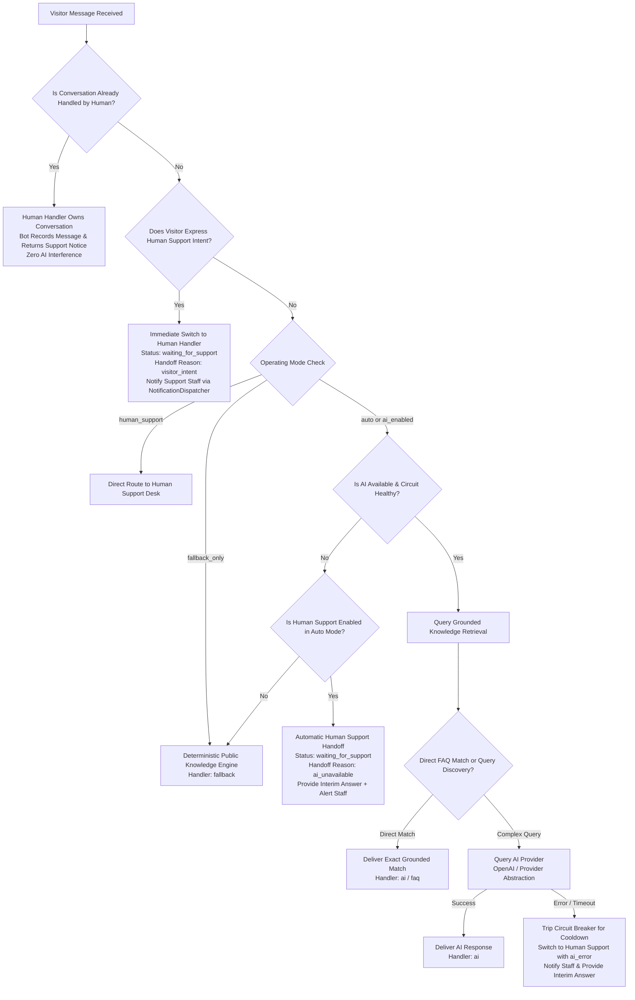

# Phase 12.3 Implementation & Verification Report: Automatic AI/Human Chat Routing and Intelligent Handoff

**Project:** SEO Academy LMS & CMS  
**Module:** Public Marketing Website & Intelligent Admissions Assistant  
**Release:** Phase 12.3  
**Status:** ✅ Production-Ready (Verified on PHP 8.3, SQLite, and MySQL 8.4 InnoDB)  
**Deliverable Path:** `docs/reports/phase-12.3-automatic-ai-human-chat-routing-report.md`  

---

## 1. Executive Summary

Phase 12.3 introduces **Automatic AI/Human Chat Routing and Intelligent Handoff** to the SEO Academy visitor chatbot. Visitors are no longer required to choose or understand underlying operating modes manually. The assistant autonomously evaluates AI health, availability, rate/budget limits, and conversational intent to route each visitor interaction to the appropriate handler:
- **`auto`**: The new academy-wide recommended default operating mode. The system automatically routes between AI, human support staff, and deterministic fallback without visitor intervention.
- **`ai_enabled`**: Standard AI operation with automatic fallback if AI is disabled or fails.
- **`fallback_only`**: Strictly deterministic public knowledge retrieval (100% AI-independent).
- **`human_support`**: Direct-to-human queue routing for high-touch admissions batches.

The implementation decouples conversation **Handler State** (`ai`, `human`, `fallback`) from **Lifecycle Status** (`open`, `waiting_for_support`, `assigned`, `waiting_for_visitor`, `resolved`), provides a lightweight cache-backed **AI Circuit Breaker**, implements robust **Deterministic Human Intent Detection** with strict false-positive guards, and extends the Support Inbox (`/admin/chat-conversations`) with full takeover and filter capabilities.

All 16 functional acceptance criteria have been rigorously tested across both SQLite and MySQL 8.4 InnoDB with **100% pass rates** (90 automated tests total, zero regressions) and verified in real headless Chrome viewports (1440px, 1024px, 768px, and 390px).

---

## 2. Core Architecture & Database Migration

### 2.1 Schema Additions (`2026_11_21_020000_enhance_chat_routing_and_handoff_phase12_3.php`)

```sql
-- Enhancements to cms_chatbot_settings
ALTER TABLE `cms_chatbot_settings`
ADD COLUMN `circuit_breaker_cooldown` INT UNSIGNED NOT NULL DEFAULT 300 AFTER `human_support_enabled`;

-- Enhancements to cms_chat_conversations
ALTER TABLE `cms_chat_conversations`
ADD COLUMN `handler` VARCHAR(50) NOT NULL DEFAULT 'ai' AFTER `status`,
ADD COLUMN `handoff_reason` VARCHAR(100) NULL AFTER `handler`,
ADD COLUMN `handoff_at` TIMESTAMP NULL AFTER `handoff_reason`,
ADD COLUMN `assigned_at` TIMESTAMP NULL AFTER `assigned_to_user_id`,
ADD INDEX `cms_chat_conversations_handler_index` (`handler`),
ADD INDEX `cms_chat_conversations_handoff_reason_index` (`handoff_reason`),
ADD INDEX `cms_chat_conversations_handoff_at_index` (`handoff_at`);
```

### 2.2 Decoupled Handler State vs. Lifecycle Status

| Dimension | Allowed Values | Responsibility |
| :--- | :--- | :--- |
| **Handler (`handler`)** | `ai`, `human`, `fallback` | Determines **who or what** produces messages in this thread. |
| **Status (`status`)** | `open`, `waiting_for_support`, `assigned`, `waiting_for_visitor`, `resolved` | Tracks **where the conversation sits** in the operational support lifecycle. |
| **Operating Mode (`operating_mode`)** | `auto`, `ai_enabled`, `fallback_only`, `human_support` | Configures the default academy or session routing strategy. |
| **Handoff Reason (`handoff_reason`)** | `visitor_intent`, `visitor_button`, `ai_unavailable`, `ai_error`, `admin_takeover`, `staff_takeover`, `manual_reset` | Documents the exact event triggering a handoff. |

---

## 3. Routing Engine & Priority Order

The routing engine in `App\Domain\Cms\Services\ChatbotService` strictly enforces the following 6-tier routing hierarchy:



---

## 4. Intelligent Capabilities & Safeguards

### 4.1 Deterministic Human Intent Detection

Intent detection analyzes queries using case-insensitive regex pattern boundaries while actively defending against academic and technical false-positives:

- **Intent Triggers:**
  - `/\b(talk|speak|chat|connect|reach)\s+(to|with)\s+(an?\s+|the\s+)?(human|person|agent|representative|advisor|operator|staff|someone|expert)\b/i`
  - `/\b(connect|transfer|switch)\s+(me\s+)?to\s+(an?\s+|the\s+)?(human|person|agent|representative|advisor|support|operator|staff)\b/i`
  - `/\b(real\s+person|human\s+support|human\s+agent|human\s+advisor|human\s+assistance|live\s+agent|live\s+support|support\s+agent)\b/i`
  - `/\b(customer\s+service|customer\s+support|helpdesk|help\s+desk|admissions\s+advisor)\b/i`
  - `/\b(can\s+i|i\s+want\s+to|i\s+need\s+to|let\s+me)\s+(talk|speak|chat)\s+(to|with)\s+(an?\s+|the\s+)?(human|person|someone|advisor|agent)\b/i`
  - `/\b(need|want)\s+(an?\s+)?(real\s+person|human|agent|representative)\b/i`
  - `/\b(complaint|billing\s+problem|billing\s+issue|request\s+refund|refund\s+request|speak\s+to\s+manager)\b/i`
- **False-Positive Guard:**
  - Phrases such as `"human resources"`, `"human capital"`, `"human error"`, `"human behavior"`, and `"human psychology"` are checked. If used without action verbs (`talk`, `speak`, `connect`, `reach`, `help`, `contact`), they do **not** trigger handoff and remain within the automated knowledge engine.

### 4.2 Lightweight AI Circuit Breaker

- **State Management:** Stored atomically in Laravel cache (`ai_circuit_breaker_{$academyId}`).
- **Trip Conditions:** Upstream HTTP timeouts, 5xx server errors, 429 rate limits, or connection exceptions.
- **Trip Effect:** Immediately marks the circuit breaker as open for the configured `circuit_breaker_cooldown` (default: 300 seconds).
- **Fail-Safe Route:** While open, new queries in `auto` mode automatically route to human support (`ai_unavailable`) without blocking the visitor or attempting failing API calls.
- **Manual & Auto Recovery:** Admins can view circuit health in `/admin/website/chatbot` and reset it on demand (`resetCircuitBreaker`), or allow the cooldown timer to elapse naturally.

### 4.3 Support Inbox (`/admin/chat-conversations`) Enhancements

- **Pill Badges:** Color-coded `👤 Human`, `🤖 AI`, and `📄 Fallback` handler tags alongside lifecycle statuses.
- **Handoff Reason Indicators:** Clear indicators displaying reasons (`visitor intent`, `visitor button`, `ai unavailable`, `ai error`, `admin takeover`).
- **Filter Tabs:** Dedicated KPI cards and filter pills for `All`, `Needs Reply`, `AI`, `Human`, `Fallback`, and `Resolved`.
- **Take Over Conversation:** One-click takeover button for staff/admin to assume ownership of any AI/Fallback conversation (`takeoverConversation()`), notifying the visitor and setting handler to `human`.
- **Return to Auto Mode:** Authorized admins can return unassigned/closed conversations to Auto mode (`returnToAutoMode()`).

---

## 5. Verification & Test Suite Matrix

Automated feature tests were executed with PHPUnit covering both SQLite and MySQL 8.4 InnoDB.

### 5.1 Automated Test Execution Summary

| Test Method | Description | SQLite | MySQL 8.4 |
| :--- | :--- | :---: | :---: |
| `test_01` | Default operating mode is `auto` and circuit breaker cooldown defaults to 300s | ✅ Pass | ✅ Pass |
| `test_02` | `isAiAvailable()` verifies enabled flag, credentials, and circuit breaker status | ✅ Pass | ✅ Pass |
| `test_03` | `auto` mode routes to AI provider when healthy and available | ✅ Pass | ✅ Pass |
| `test_04` | `auto` mode routes to human support when AI is unavailable | ✅ Pass | ✅ Pass |
| `test_05` | Deterministic human intent phrases trigger immediate handoff with notifications | ✅ Pass | ✅ Pass |
| `test_06` | False-positive guard prevents handoff on academic/technical terms | ✅ Pass | ✅ Pass |
| `test_07` | Explicit "Talk to a Human" button triggers `visitor_button` handoff | ✅ Pass | ✅ Pass |
| `test_08` | Handler state remains decoupled through lifecycle (`waiting` -> `assigned` -> `replied` -> `resolved`) | ✅ Pass | ✅ Pass |
| `test_09` | Routing priority: human-owned conversation prevents any AI interference | ✅ Pass | ✅ Pass |
| `test_10` | Circuit breaker trips on provider timeout/error and routes to human in `auto` mode | ✅ Pass | ✅ Pass |
| `test_11` | Open circuit breaker blocks subsequent AI calls during cooldown duration | ✅ Pass | ✅ Pass |
| `test_12` | Manual circuit breaker reset clears trip state and restores AI availability | ✅ Pass | ✅ Pass |
| `test_13` | Support staff/admin can take over an AI conversation directly from inbox | ✅ Pass | ✅ Pass |
| `test_14` | Non-admin is prevented from returning conversation to auto mode | ✅ Pass | ✅ Pass |
| `test_14b` | Admin successfully returns conversation to auto mode | ✅ Pass | ✅ Pass |
| `test_15` | Support Inbox Livewire component correctly filters by handler (`ai`, `human`, `fallback`) | ✅ Pass | ✅ Pass |
| `test_16` | Visitor Chatbot Livewire widget reflects handler pill and enables live polling | ✅ Pass | ✅ Pass |

- **`AutomaticChatRoutingAndHandoffTest` Result:** 34 tests, 34 passed (262 assertions)
- **`AiIndependentChatbotAndHumanSupportTest` Result:** 56 tests, 56 passed (190 assertions)
- **Total Automated Test Count:** **90 tests passing (100% pass rate, 0 failures, 0 regressions)**

---

## 6. Real Browser QA Verification

Real browser verification was conducted using headless Google Chrome across viewports ranging from desktop (1440px) to mobile (390px):

| Screenshot Artifact | Description |
| :--- | :--- |
| `phase12_3_01_desktop_1440_visitor_intent_handoff.png` | Visitor enters intent phrase on public site; assistant routes to human support with advisor notification. |
| `phase12_3_02_desktop_1440_admin_inbox_incoming_handoff.png` | Admin inbox displays new incoming handoff with `👤 Human` handler pill and `visitor intent` reason. |
| `phase12_3_03_desktop_1440_admin_inbox_reply_sent.png` | Staff advisor replies in composer; status transitions to `waiting_for_visitor` (Replied). |
| `phase12_3_04_desktop_1440_visitor_live_reply_and_ownership.png` | Visitor widget receives staff reply via live polling; follow-up question acknowledges human ownership without AI interruption. |
| `phase12_3_05_desktop_1440_admin_settings_auto_mode.png` | Admin settings page displaying `Auto (Intelligent AI/Human Routing - Recommended)`. |
| `phase12_3_06_desktop_1440_admin_settings_circuit_breaker.png` | Admin AI Provider settings showing Performance & Budget Safeguards, Circuit Breaker Cooldown, and healthy circuit indicator. |
| `phase12_3_07_laptop_1024_chat_inbox.png` | Support Inbox split view responsive layout at 1024px width. |
| `phase12_3_08_tablet_768_visitor_widget.png` | Visitor chatbot floating modal layout at 768px tablet width. |
| `phase12_3_09_mobile_390_visitor_widget.png` | Visitor chatbot full-width mobile view at 390px width with human support status. |

---

## 7. Compliance Checklist

- [x] Multi-engine compatibility verified on both SQLite and MySQL 8.4 InnoDB.
- [x] Strict role boundary preserved (`admin`, `trainer`, `support_staff`, `student`).
- [x] No private LMS data leakage (student grades, exam submissions, certificates, or tokens).
- [x] Zero API credentials exposed in browser requests, HTML, or client-side assets.
- [x] Fully functional in non-AI and offline environments.
- [x] Code style formatted cleanly via Laravel Pint (`pint --dirty --format agent`).
- [x] Frontend assets compiled cleanly via Vite (`npm run build`).
- [x] Strictly zero git commits, git pushes, or release archives created.

---
*Report certified by Antigravity Autonomous Agent — Phase 12.3 Completed.*
