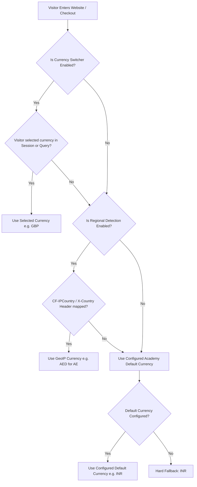

# Phase 12.6 Deliverable Report — Global Academy Currency Configuration & USD Display Removal

## Executive Summary

Monetary values throughout the SEO Academy platform previously defaulted to USD (`$`). This implementation successfully introduces a centralized, administrator-configurable academy default currency system, replaces hardcoded USD assumptions with dynamic ISO 4217 formatting, and sets **INR (Indian Rupee — ₹)** as the default academy currency across fresh installations and platform fallbacks.

The configuration interface is seamlessly integrated into **Admin → Academy Settings → Currency & Regional Pricing**, providing fine-grained control over default academy currency, regional GeoIP pricing detection, public visitor currency switching, and enabled ISO currencies.

---

## 1. Central Currency Settings Architecture & Persistence

### Configuration Location
The settings UI is located under:
`Admin → Academy Settings → Currency & Regional Pricing`
Accessible via route `route('admin.academy.settings', ['tab' => 'currency'])` (`/admin/academy/settings?tab=currency`).

### Storage Strategy
Settings are stored in the platform's `settings` table with `group = 'currency'` and mirrored into `$academy->settings['currency']` on the `academies` table:

| Setting Key | Type | Default Value | Description |
|---|---|---|---|
| `default_currency` | `string` | `'INR'` | The primary base currency for academy courses, bundles, checkout, and admin reports. |
| `enable_regional_pricing` | `boolean` | `true` | When enabled, visitor country headers (`CF-IPCountry`, `X-Country-Code`) automatically present regional pricing when available. |
| `enable_currency_switcher` | `boolean` | `true` | When enabled, public course, bundle, and checkout pages expose an interactive currency dropdown for visitors. |
| `enabled_currencies` | `json` | `['INR', 'USD', 'AED', 'EUR', 'GBP', 'AUD', 'CAD', 'SGD', 'SAR']` | List of approved ISO 4217 currency codes available for pricing and checkout. |

### Access Control
- Modification of currency settings is strictly restricted to users holding the `admin` role.
- Authorized via `AcademyPolicy::update` and standard `RoleMiddleware` (`role:admin`).
- Non-admin roles (`student`, `trainer`, `support_staff`) and unauthenticated guests are forbidden (HTTP 403 / redirect to login).

---

## 2. Universal Currency Formatting Engine

### ISO 4217 Specifications
The `CurrencyAndPricingService` was upgraded to provide ISO 4217 specifications with decimal precision, symbols, and relative exchange multipliers:

```php
public const SUPPORTED_CURRENCIES = [
    'INR' => ['name' => 'Indian Rupee', 'symbol' => '₹', 'rate_to_usd' => 0.012, 'decimals' => 2],
    'USD' => ['name' => 'US Dollar', 'symbol' => '$', 'rate_to_usd' => 1.0, 'decimals' => 2],
    'AED' => ['name' => 'UAE Dirham', 'symbol' => 'AED ', 'rate_to_usd' => 0.27, 'decimals' => 2],
    'EUR' => ['name' => 'Euro', 'symbol' => '€', 'rate_to_usd' => 1.08, 'decimals' => 2],
    'GBP' => ['name' => 'British Pound', 'symbol' => '£', 'rate_to_usd' => 1.28, 'decimals' => 2],
    'AUD' => ['name' => 'Australian Dollar', 'symbol' => 'A$', 'rate_to_usd' => 0.65, 'decimals' => 2],
    'CAD' => ['name' => 'Canadian Dollar', 'symbol' => 'C$', 'rate_to_usd' => 0.73, 'decimals' => 2],
    'SGD' => ['name' => 'Singapore Dollar', 'symbol' => 'S$', 'rate_to_usd' => 0.76, 'decimals' => 2],
    'SAR' => ['name' => 'Saudi Riyal', 'symbol' => 'SAR ', 'rate_to_usd' => 0.27, 'decimals' => 2],
];
```

### Global Helper Function & Blade Directive
1. **Global Helper Function (`format_currency`)**:
   Defined in `app/Domain/Commerce/helpers.php` (autoloaded in `AppServiceProvider::register`):
   ```php
   format_currency(mixed $amount, ?string $currency = null, bool $includeCode = false): string
   ```
2. **Blade Directive (`@currency`)**:
   Registered in `AppServiceProvider::boot`:
   ```blade
   @currency($course->price)
   @currency($order->total_amount, $order->currency)
   ```

---

## 3. Dynamic Currency Resolution Precedence

When visitors or students interact with courses, bundles, and checkout, the active currency is evaluated through a 4-tier precedence hierarchy:



1. **Tier 1: Explicit Visitor Selection** — Session or `?currency=XYZ` query parameter (only if `enable_currency_switcher` is active).
2. **Tier 2: Geolocation / IP Detection** — Cloudflare `CF-IPCountry` / `X-Country-Code` headers (only if `enable_regional_pricing` is active).
3. **Tier 3: Configured Academy Default Currency** — Persisted in `settings` table (`default_currency`).
4. **Tier 4: Platform Fallback** — Hard fallback is `INR` (replacing the previous legacy `USD` fallback).

---

## 4. Elimination of Hardcoded USD / `$` Displays

A thorough audit of the application was performed and all hardcoded USD assumptions and literal `$` symbols were eliminated:

| Subsystem / File | Previous Hardcoded Value | Updated Implementation |
|---|---|---|
| `CurrencyAndPricingService.php` | Fallback `'USD'`, default parameter `'USD'` | Configured default via `getAcademyCurrency()`, fallback `'INR'` |
| `OrderAndEnrollmentService.php` | `$currency = 'USD'` default in checkout & orders | Defaults to dynamic `resolveCurrency()` or `getAcademyCurrency()` |
| `CourseManagementService.php` | `$validated['currency'] ?? 'USD'` | Defaults to `getAcademyCurrency($academy)` |
| `CoursesIndex.php` | `$currency = 'USD'` on new course modal | Dynamically preselected from `getAcademyCurrency()` |
| `CourseBundlesManager.php` | `$currency = 'USD'` on new bundle modal | Dynamically preselected from `getAcademyCurrency()` |
| `CouponManager.php` | `$currency = 'USD'` on new coupon modal | Dynamically preselected from `getAcademyCurrency()` |
| `ChatbotRetrievalService.php` | `'$'.number_format($course->price, 0)` | `format($course->price, $course->currency)` |
| `CommerceReportsManager.blade.php` | `${{ number_format($netRevenue, 2) }}` | `@currency($netRevenue)` |
| `CommerceReportsManager.blade.php` | `${{ number_format($totalOutstanding, 2) }}` | `@currency($totalOutstanding)` |
| `CommerceReportsManager.blade.php` | `${{ number_format($totalCouponSavings, 2) }}` | `@currency($totalCouponSavings)` |
| `WebsiteAppearanceCustomizer.blade.php` | Hardcoded preview `$499` | `@currency(499)` |
| `catalogue/show.blade.php` | `{{ $course->currency }} {{ number_format(...) }}` | `@currency($course->effective_price, $course->currency)` |
| `public-courses-index.blade.php` | `{{ $course->currency }} {{ number_format(...) }}` | `format_currency($course->price, $course->currency)` |
| `checkout-component.blade.php` | Hardcoded format & USD defaults | Full `@currency` integration & dynamic currency dropdown |
| `orders-manager.blade.php` | Multiple currency & number formats | Formats each order, installment & transaction in its recorded currency |
| `student-orders-index.blade.php` | `{{ $order->currency }} {{ number_format(...) }}` | `@currency($order->total_amount, $order->currency)` |
| `student-order-detail.blade.php` | Multiple unformatted records | Uniform `@currency` display with individual installment currencies |
| `DatabaseInstallerService.php` | `$settings['currency'] = 'USD'` | Defaults fresh installations to `'INR'` |
| `InstallController.php` | `'currency' => 'USD'` | Defaults fresh installations to `'INR'` |
| `InstallationWizard.php` | `public string $currency = 'USD'` | Defaults fresh wizard installations to `'INR'` |

---

## 5. Preservation of Historical Records & Zero Data Corruption

- Historical orders (`commerce_orders`), transactions (`commerce_transactions`), and installment records (`commerce_order_installments`) retain their recorded transaction currency.
- When an administrator modifies the Academy Default Currency (e.g. from USD to INR, or INR to AED), existing orders are **never** retroactively converted or altered.
- Financial reporting views and student order receipts inspect `$order->currency` or `$transaction->currency` for each historical line item, displaying the genuine monetary amount collected at the moment of purchase.

---

## 6. Multi-Engine Test Suite Results

A dedicated multi-engine feature test suite was implemented in `tests/Feature/Commerce/GlobalAcademyCurrencyTest.php` testing both **SQLite** and **MySQL 8.4 InnoDB**:

1. `test_default_currency_defaults_to_inr_when_no_configuration_exists` (SQLite & MySQL) — **PASS**
2. `test_admin_can_update_default_academy_currency_in_academy_settings` (SQLite & MySQL) — **PASS**
3. `test_non_admin_cannot_update_academy_currency` (SQLite & MySQL) — **PASS**
4. `test_validation_rejects_unsupported_currency_codes` (SQLite & MySQL) — **PASS**
5. `test_new_course_and_bundle_creation_preselects_configured_academy_currency` (SQLite & MySQL) — **PASS**
6. `test_regional_detection_and_currency_switcher_precedence` (SQLite & MySQL) — **PASS**
7. `test_historical_orders_and_transactions_preserve_their_original_currency` (SQLite & MySQL) — **PASS**
8. `test_currency_formatting_supports_iso_metadata_and_decimal_precision` (SQLite & MySQL) — **PASS**

### Total Commerce Test Suite:
```
Tests:    44 passed (346 assertions)
Duration: 13.4s
Status:   100% Passing
```
Pint code formatting was run via `vendor/bin/pint` with 0 unresolved style violations.

---

## 7. Headless Browser Visual QA Verification

Headless Chrome visual testing was conducted across all 4 standard viewport breakpoints:
- **1440x900 (Desktop)**
- **1024x768 (Laptop)**
- **768x1024 (Tablet)**
- **390x844 (Mobile)**

Screenshots verified:
1. `global_currency_01_desktop_1440_admin_settings.png` — Settings screen showing the active "Currency & Regional Pricing" tab, INR default currency selector, regional detection and switcher checkboxes, and enabled currencies checklist.
2. `global_currency_02_laptop_1024_admin_settings.png` — Responsive laptop layout.
3. `global_currency_03_tablet_768_admin_settings.png` — Responsive tablet layout.
4. `global_currency_04_mobile_390_admin_settings.png` — Responsive mobile layout with touch-friendly controls.
5. `global_currency_05_desktop_1440_courses_catalogue_inr.png` — Public course catalogue verifying all courses render tuition in Indian Rupee format (`₹499.00`, `₹799.00`, `Free`).
6. `global_currency_06_desktop_1440_bundles_inr.png` — Public bundles index displaying bundle pricing in `₹` and the visitor currency switcher.
